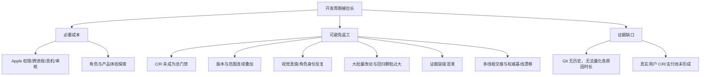
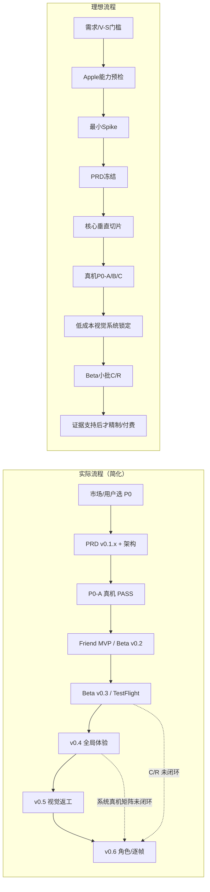

# Focumi / 自律宠物开发完整复盘：问题根因与改进 SOP

> 审计日期：2026-08-14  
> 状态：**待主总控验收**  
> 性质：严格只读历史审计；除本文件外未修改项目、源码、配置、PRD、架构或既有报告  
> 根目录：`/Users/USER/Documents/app/自律宠物-iOS`；上级资料目录：`/Users/USER/Documents/app`

## 1. 一屏执行摘要

### 1.1 结论

Focumi 做久了，不是单一原因，也不能概括为“早期架构差”或“AI 写代码不够快”。最强证据支持以下排序：

1. **产品/验证阶段没有成为所有后续投入的硬总门禁（高影响、高可避免）**：项目在真实 C/R 尚未形成时，连续进入 Beta v0.2 功能、v0.3 商业问卷、v0.4 全局体验、v0.5 少女编辑视觉、v0.6 逐帧角色生产。P0 是用户资源配置决定，不是市场已证最佳。
2. **视觉真值与角色身份多轮改写（高影响、中高可避免）**：从早期猫/狗/兔、Milo/Max 透明帧，到电影光束、Vintage Shōjo、Max→Toto/Pomeranian 探索→恢复 Max，再到 Gate 1 concept-first 与 Return signature production；已有“本地视觉已收敛”结论被真机 Pact 截图推翻。
3. **Apple 系统能力与真机证据是必要硬成本（高影响、低可避免）**：Family Controls entitlement、四 target、App Group、Shield Action、DeviceActivity、真机传播延迟、撤权崩溃、Live Activity 系统表面均不能由模拟器替代。P0-A 最终 PASS，说明探索不是白做；但 P0-B/P0-C 与系统表面仍没有同等级完整闭环。
4. **版本/范围叠加快于基线治理（高影响、高可避免）**：PRD v0.1.3→v0.1.4→v0.1.5 后，又出现 Beta v0.2/v0.3/v0.4/v0.6；项目 `AGENTS.md` 仍写 v0.3 为当前产品基线，而源码配置已经是 `0.5.0 (7)`，v0.6 又在生产素材，形成“技术基线、产品基线、视觉基线、当前执行门”多头并存。
5. **实现和验收颗粒过大（中高影响、高可避免）**：`FriendMVPView.swift` 3,211 行、`FriendMVPModel.swift` 834 行；一次视觉改造跨安全区、Focus、Return、Completion、弹窗、本地化、Live Activity、可访问性，出现新文件未进 Xcode source list、Return 遮挡、locale 测试依赖宿主、截图路径失效、测试 runner 中断等回归。

### 1.2 最重要的反证

- **反证“早期完全没架构”**：【事实】架构 v1.1 在编码前已覆盖四产品 target、单元测试 target、App Group 版本化信封、Reducer/Effect/Client、generation/TTL、撤权、冷启动、通知与真机门禁；当前源码也能看到这些边界。因此应批评的是“后续体验层继续膨胀、门禁没有统治投入”，不是把所有问题倒推成架构缺失。
- **反证“先做 UI 才验证技术”**：【事实】2026-08-10 P0-A 真机完成授权、选择、Shield、官方打开、热/冷 intent、解除/重锁、3/3 传播轮与撤权复测，早于 8 月 11–14 的主要视觉生产。真正的顺序错误是：**P0-A 之后没有先完整闭合 P0-B/P0-C 和真实用户 C/R，就持续扩大产品/视觉层。**
- **反证“Apple 全是借口”**：【事实】撤权首次真机触发 Swift 6/XPC 队列 `SIGTRAP`，模拟器/单测无法替代；Dynamic Island 黑底、Shield 布局、DeviceActivity 回调时机也是系统边界。这些是必要探索。
- **反证“TestFlight 已证明价值”**：【事实】Build 6 后来显示已批准，但持久状态记录为外部组 0 测试员；批准、构建、截图都不构成 C/R 或付费。

### 1.3 核心判断

“技术不是瓶颈”只在狭义上部分成立：普通 SwiftUI 页面和本地状态实现速度不是最大瓶颈；但在 Family Controls 产品中，**Apple 权限、跨进程状态、真机系统行为和审核资格本身就是产品可行性的一部分**。P0-A 通过以后，瓶颈才转移到产品承诺、视觉身份、真实用户 C/R 与制作质量。不能把这两个阶段混成一句话。

---

## 2. 资料范围、证据等级和限制

### 2.1 规则与启动门禁

- `/Users/USER/Documents/app/AGENTS.md`：SHA-256 `b9d82fdf0df094829c2c0d25eb3a418f2368ada668352be6140736426b94dd89`；mtime `2026-08-11 14:27:08 +0800`。
- `/Users/USER/.codex/AGENTS.override.md`：不存在。
- `/Users/USER/.codex/skills/chronicle/SKILL.md`：SHA-256 `df64e9c38611b1653d29d760ada21f64b450de31895a75c3071691da99cf1129`；mtime `2026-06-19 13:24:21 +0800`。
- 项目 `/Users/USER/Documents/app/自律宠物-iOS/AGENTS.md`：SHA-256 `e7598899c7ac62268d62a37ce3cbc94fc77eecb9c5c4a1b68ea2233262afe926`；mtime `2026-08-12 10:13:36 +0800`。

### 2.2 证据等级

| 等级 | 证据 | 本报告用法 |
|---|---|---|
| A | 当前源码、配置、Git、真实文件 | 当前实现与结构事实；最高优先级 |
| B | 真机、测试、验收、Apple 状态报告 | 只按报告明确范围承认，不外推 |
| C | PRD、架构、设计决策 | 证明当时计划/约束，不证明实现 |
| D | Codex 正式任务 final/rollout summary | 时间线与 Owner 回报；需 A–C 交叉 |
| E | Chronicle/Memory | 历史定位和观察；不得覆盖强证据 |
| F | 推断 | 明确标【推断】，保留替代解释 |

关键结论统一使用：**【事实】、【历史观察】、【推断】、【未知】**。

### 2.3 审阅范围与限制

- 审阅/定向扫描：30 份项目 Markdown 文档、3 个早期 PRD 文件、2 个架构版本、48 个 Swift 文件（约 8,520 行）、5 个产品/扩展 target + 1 个测试 target、97 个 `Evidence` 文件、5 个 asset catalog、110 个 imageset。
- 当前代码最大文件：`FriendMVPView.swift` 3,211 行；`FriendMVPModel.swift` 834 行；`FriendMVPReducerTests.swift` 803 行。
- Git 限制：【事实】上级仓库只有 2026-08-01 一个初始提交；Focumi 项目和多数相关文档是 untracked，无法从 Git 重建逐次 diff、作者或真实工时。**本报告不以 mtime 推算耗时。**
- Chronicle 限制：Skill 要求通过提权宿主进程检查确认 recorder；本任务无提权批准，故未使用原始屏幕/OCR，仅使用持久 Chronicle memory，并降级为 E 级。
- Codex task 限制：`list_threads` 成功；`read_thread` 先遇到参数上限，纠正后触发平台 IPC frame 超限，按规则停止重试。正式任务细节改由 rollout summary 与文件证据交叉。
- Apple 当前状态限制：本轮禁止连接 App Store Connect/TestFlight/真机；Build 6 “已批准、外部组 0 测试员”是历史持久记录，不是 2026-08-14 实时复核。
- 敏感配置：签名/Team 等配置位于 `project.yml`、Xcode project 与 provisioning 相关文件；本报告只指出位置，不复述标识或凭据。

---

## 3. 完整时间线

> 日期是文档/证据日期或正式任务观察日期，不代表连续投入时长。

| 日期/阶段 | 当时目标 | 做了什么与证据 | 结果 | 随后为何改变 |
|---|---|---|---|---|
| 2026-07-26～08-08 机会研究 | 找到可做的个人 App 方向 | 【历史观察】PMO 进行海外需求/榜单研究，多数候选 0 绿灯；Focumi 被用户设为唯一 P0 | P0 是资源选择，不是市场最佳证明 | 需要进一步产品定义与 Apple 可行性验证 |
| 2026-08-09 方向核验 | 收窄自律宠物 | 【事实】`自律宠物App_严格只读独立方向核验_2026-08-09.md`、PRD v0.1.3 | 首批人群、宠物陪伴、社媒阻断闭环成形；仍待评审 | 产品细节和 Apple 行为存在大量开放问题 |
| 2026-08-09 PRD v0.1.2（缺文件） | 早期范围选择 | 【历史观察】Chronicle 记录 v0.1.2、三选一与角色方向；当前未找到文件 | 只能作为存在下限，不能审具体差异 | 进入 v0.1.3 正式文件 |
| 2026-08-09 PRD v0.1.3 | 三宠完整 P1 | 【事实】猫/狗/兔、喂食/洗澡/玩耍、一次换宠、好感度衰减；代码/视觉/P0 均未开始 | 产品想象较完整，但资产量和惩罚语义风险高 | 对抗审查与 Apple 能力预检推动 v0.1.4 |
| 2026-08-10 环境只读预检 | 判断能否进入 P0 | 【事实】Xcode/SDK/模拟器/真机基础可用；当时没有 Focumi Xcode 工程或源码；Family Controls/entitlement 未证 | `READY_FOR_P0_PREFLIGHT`，不是 P0 PASS | 先补 PRD/架构和账号/真机门禁 |
| 2026-08-10 PRD v0.1.4 | 把开放问题变为 P0 问题 | 【事实】双语、权限后置 onboarding、10/30/60 提醒、无普通暂停、单写入者/四 target 等更明确 | 仍是待最终验收 | 第二轮审查继续补状态真实性、测量与恢复 |
| 2026-08-10 PRD v0.1.5 | 冻结 P0 验证基线 | 【事实】状态 `APPROVED FOR P0 VALIDATION`；明确系统无 API 查询真实 Shield、通知非权威、多窗口、累计通行、真机矩阵 | PRD 只授权 P0，不是完整开发绿灯 | 架构 v1.1 对应收紧 |
| 2026-08-10 架构 v1.0→v1.1 | 建立可恢复的跨 target 结构 | 【事实】四产品 target + 测试、Reducer/Effect/Client、App Group 信封、generation/TTL、P0-A/B/C | v1.1 获准用于 P0 | 开始建立工程与 capability spike |
| 2026-08-10 首个 Xcode 工程 | 实现 P0-A 骨架 | 【事实】创建工程/target/tests；处理 XcodeGen 同名 group 死循环、SDK switch 变化、Swift 6 隔离、test Info.plist | 本地 build/test/analyze/simulator PASS | 仍需账号、签名和真机系统行为 |
| 2026-08-10～11 P0-A 真机 | 验证 Apple 核心能力 | 【事实】授权、选择、Shield、`.close`、`openParentalControlsApp`、热/冷 intent、清除/重锁、3/3 ≤8 秒、撤权复测 | **P0-A PASS**；首次撤权曾崩溃，修复后 PASS | 可进入 P0-B，但不等于完整产品或市场绿灯 |
| 2026-08-11 Friend MVP | 给 5–10 人的窄流程 | 【事实】宠物→目标→选择→临时使用→Return→鼓励；真机 build/install/launch | UI/恢复可见；完整 Shield/Return 人工矩阵仍需走 | 用户希望更完整、可测试的 Beta 体验 |
| 2026-08-11 Beta v0.2 | 增加可用性与宠物内容 | 【事实】Milo/Max、32 张运行时帧、自由专注、音乐、四时长、换宠、主题；29/32 测试版本报告 | 本地/模拟器收口；后台音频、真机截止恢复、朋友批次待验 | 审查发现数据损坏、设置、DeviceActivity 截止问题并修复 |
| 2026-08-12 Beta v0.3 | 为陌生用户/商业验证准备 | 【事实】本地去标识事件、一次性购买意愿、权限前说明、Live Activity 用 Milo/Max、重复结束修复；本地 `0.3.0 (4)` | 真机完整矩阵仍待；产品价值尚未证 | 另一路 Build 6 进入 TestFlight 审核 |
| 2026-08-09～13 TestFlight Build 6 | 外部 Beta 审核 | 【历史观察】`0.3.0 (6)` 上传并提交；后续持久记录显示已批准、外部组 0 测试员 | Apple 审核阶段通过不等于用户可用/价值 | 尚需 tester 获取、安装、核心动作和 D2/D7 |
| 2026-08-12 v0.4 Return Loop | 从功能工具转为陪伴体验 | 【事实】参考 Cat on Chair 机制但排除复制；重做 Focus/Return/Completion、Live Activity、结束确认、可访问性；55/58 测试报告与部分真机覆盖安装 | 本地视觉多轮 PASS，但真实 Shield/LA/Return 系统矩阵仍未闭合 | 用户继续要求整体视觉风格重做 |
| 2026-08-12～13 电影光束→Vintage Shōjo | 重建整体视觉系统 | 【事实】Cinematic beam、Vintage Shōjo、editorial rework；真机 Pact 截图推翻“本地视觉已收敛” | 出现主题持久化污染、对比不足、CTA 不可达、白圈；后续修正 | 说明截图环境和真机尺寸是独立门禁 |
| 2026-08-13 v0.6 Gate 0/1 | 让角色通过连续表演成为产品 | 【事实】Gate 0 Milo Return 用户 PASS；旧程序化 Gate 1 被标 `REJECTED_FOR_FORMAL_CHARACTER_PRODUCTION`；concept-first 多轮生成，Milo 锁定，Max/Toto/Pomeranian/Husky 路线反复 | 角色身份发生 Max→Toto→恢复 Max 的路线回退；视觉合同部分冻结 | 进入现有宠物体验重构与 Return animatic |
| 2026-08-13 Checkpoint A | 用现有 Milo/Max 静态姿势重构 UI | 【事实】66 tests/6 suites、全 target build、本地截图矩阵；AXXXL/Reduce Motion/系统表面仍有 gap | `WAITING_USER_CHECKPOINT_A_REVIEW` | 继续 Checkpoint B Return 表演/正式逐帧 |
| 2026-08-14 Return Signature Production | 生产 Milo/Max Return 正式帧 | 【事实】目录存在 232 个文件、约 129 MB，包含 42 个 frames 路径及 review render/contact sheet；相关 Codex task 仍 active | **只能判进行中产物**；没有找到同级正式验收 Markdown | 待 Owner 回报与主总控/用户验收；不得从文件存在推断通过 |

### 3.1 可证实数量

- PRD/产品规格：当前可读至少 **7 份主版本/范围**（v0.1.3、v0.1.4、v0.1.5、Beta v0.2、Beta v0.3、v0.4、v0.6；另有 v0.1.2 历史观察但文件缺失；v0.6 存在两份侧重点不同的执行/动画 PRD）。
- 架构：**2 个正式版本**（v1.0、v1.1）。
- 可辨识版本/build：至少 **5 个**：`0.2.0 (1)`、`0.3.0 (4)`、`0.3.0 (6)`、`0.4.0 (7)`、当前配置 `0.5.0 (7)`；`0.6.0` 仅候选，无可核 build。
- 主要视觉/角色重做：至少 **6 条路线/阶段**：早期三宠概念、透明 Milo/Max 帧、Companion/Cinematic、Vintage Shōjo Editorial、Gate 1 concept-first（含 Toto/Max 品种分叉）、v0.6 Return Signature。
- 主要技术门禁：P0-A、P0-B、P0-C、P0.5、真机系统表面、TestFlight、C/R/支付，至少 **7 层**。
- 正式任务：本轮直接识别/交叉至少 **7 个 Focumi 相关 thread_id**；任务列表只返回最近 50 项，不能声称全量。

---

## 4. 为什么做了这么久：因果树与排序



| 排名/假设 | 影响 | 可避免 | 支持/阻断证据 | 反证 | 残余未知 |
|---|---|---|---|---|---|
| 1. 真实 C/R 未统治投入 | 高 | 高 | V-S-C-R 规则要求先证行为；但版本从 v0.2 推到 v0.6，外部组历史为 0 tester | 技术和体验准备是招募前必要条件 | 是否已有未记录的真实朋友复用 |
| 2. 视觉/角色多轮重做 | 高 | 中高 | 真机截图推翻本地收敛；Max→Toto→Max；旧 Gate 1 被拒；多套视觉文档和资产 | 视觉探索本身必要，用户审美只能通过样片发现 | 每轮实际工时与可复用比例 |
| 3. 版本/范围叠加 | 高 | 高 | v0.1.x、Beta 0.2/0.3/0.4、v0.5 config、v0.6 production 并存 | 每版都有新学习，并非全部无关 | 哪一版曾被用户明确宣布“产品冻结” |
| 4. Apple 外部硬约束 | 高 | 低 | entitlement、Shield 系统表面、撤权真机崩溃、LA/Island/DeviceActivity 限制 | P0-A 已通过，不能继续把之后所有慢都归 Apple | Family Controls distribution 当前实时状态 |
| 5. 改动/验收范围过大 | 中高 | 高 | 一轮覆盖多页面、多系统表面、本地化/AX；多次出现集成/截图/测试回归 | 全局风格重做本就需要跨页面一致性 | 每次任务是否有未保存的更细变更单 |
| 6. 证据层级混淆 | 中高 | 高 | 报告反复声明 build/simulator/截图不等于真机；历史 PASS 又被真机推翻 | 项目后期已显著强化 truth boundary | 早期有多少决策确因误判而非单纯缺设备 |
| 7. PRD 早期不完整/反复 | 中 | 中 | v0.1.3 有 13 个开放问题；v0.1.4/v0.1.5补通知、窗口、状态真实性、测量 | v0.1.5 已较完整，且先于编码；无法解释后续全部视觉返工 | v0.1.2 缺文件，无法完整比较 |
| 8. 架构未覆盖多 target/恢复 | 中（早期）/低（当前） | 中 | 初始想法阶段无工程；首次实现遇到跨 target/Swift 6/Info.plist 问题 | v1.1 在工程前已覆盖核心拓扑；当前代码存在分层和测试 | P0-B/P0-C 全量矩阵仍未闭合 |
| 9. 大 View/职责混合 | 中 | 高 | 3,211 行 View 内含多页面、样式、问卷、设置、调试预览；Model 还含音频/monitor | Domain/Store/Live Activity 已拆分，不是无架构 | 运行时性能未 profile，本轮不能断言性能事故 |
| 10. 多线程/Owner/交接 | 中 | 中高 | 正式 PMO、predecessor、Gate1、Return production 等多任务；基线文档状态落后当前 config | 多线程也提供独立审查和门禁 | `read_thread` 平台失败，不能完整统计交接失真次数 |
| 11. 用户中途改变方向 | 中高 | 中 | 从功能完整到全局视觉、再到逐帧角色；多次明确审美拒绝 | 很多改变是看到真机/样片后的合理发现；不能归咎用户 | 若早期先做低成本视觉原型，可减少多少返工 |
| 12. 市场研究与开发并行/分散 | 中 | 中高 | 机会研究继续进行，同时 Focumi 已是唯一 P0；价值证据仍未形成 | 去重研究可防止盲目押注，且没有候选取代 P0 | 各研究实际占用同一 Owner/时段无法量化 |

### 4.1 因果链，而非单点责任

【推断】最符合证据的链条是：用户选 P0 → PRD/架构和 P0-A 做得相对扎实 → capability 通过带来“可以继续做”的信心 → 朋友/Beta 功能快速增加 → 真实 C/R 尚未回来时，为提升吸引力又进入商业问卷、Live Activity和全局视觉 → 真机/用户审美不断推翻局部收敛 → 角色一致性问题迫使进入更昂贵的 concept/model sheet/逐帧管线 → 版本与任务越来越多，回归面和交接成本同步扩大。

---

## 5. 问题台账（38 条）

证据缩写见附录 E01–E25。

| ID | 阶段/日期 | 症状 | 直接原因 | 根因 | 证据 | 返工/风险 | 可避免 | 后来处理 | 当前关闭 |
|---|---|---|---|---|---|---|---|---|---|
| P01 | 方向/08-09 | P0 易被表述成最佳方向 | 用户集中资源与市场证明混淆 | 决策与验证口径未分离 | E01/E21 | 过早扩大投入 | 高 | 改写为“用户选定且未被替代” | 部分 |
| P02 | V-S-C-R/至今 | 无真实 C/R 仍持续扩版 | Beta/视觉准备被当成前进依据 | 行为门禁未成为总门禁 | E01/E21 | 做出无人复用的精致产品 | 高 | 文档反复声明不等于绿灯 | 否 |
| P03 | PRD v0.1.3 | 三宠+大量动作进入 P1 | 一次追求完整核心 App | 未先用单宠物验证增量 | E02 | 资产量与一致性风险 | 高 | v1.1改为先单宠垂直切片 | 部分 |
| P04 | PRD v0.1.3 | 原宠好感度衰减与正向原则冲突 | 换宠机制借用养成逻辑 | 情绪原则未先冻结 | E02 | 文案/状态返工、内疚风险 | 高 | 后续强化不惩罚 | 部分 |
| P05 | PRD v0.1.3–1.5 | 多次补通知、窗口、测量、撤权 | 早版开放问题多 | Apple 能力与产品语义交织 | E02/E03 | 文档返工 | 中 | v0.1.5/架构v1.1收敛 | 是（P0基线） |
| P06 | 架构 v1.0 | 60 分钟规则与后续诚实状态需收紧 | 状态/系统结果边界不够细 | 早期对系统可观察性理解不足 | E04 | 错误承诺风险 | 中 | v1.1三层证据/幂等 | 是（设计） |
| P07 | 工程初建 | XcodeGen 同名 group 死循环 | 工具路径归一化冲突 | 工程生成配置未先最小 spike | E05 | 阻塞工程生成 | 中 | 删除冗余 group 映射 | 是 |
| P08 | 工程初建 | SDK 新增 Shield secondary action 导致 switch 变化 | Apple SDK API 演进 | 系统 API 版本约束 | E05 | 编译/行为遗漏 | 低 | 全部穷举处理 | 是 |
| P09 | Swift 6 | Shared Codable/Sendable 被 MainActor 污染 | 默认 actor isolation 外溢 | 跨进程 DTO 隔离边界需显式 | E05 | 编译/运行风险 | 中 | Shared/Reducer `nonisolated` | 是 |
| P10 | 测试 target | 缺 Info.plist 导致测试 PASS 不可复现 | Target 配置遗漏 | 初建验收未含干净复现 | E05 | 假通过风险 | 高 | Debug/Release 补生成设置 | 是 |
| P11 | 授权 UI | 用户拒绝时仍显示授权可用 | 成功回调被硬编码 | 系统请求返回与真实状态混淆 | E05 | 误导用户 | 高 | 请求后读取真实状态 | 是 |
| P12 | P0-A 真机 | 首次撤权崩溃 | XPC completion 被推断 MainActor | Swift 6 与旧 Apple 标注桥接 | E06 | 真机崩溃 | 低中 | 非隔离桥接+复测 PASS | 是 |
| P13 | P0-A | 单次视频容易被当最终通过 | 验收批次/阈值后置风险 | 证据协议不先冻结 | E06 | 事后调整标准 | 高 | 先试测冻结8秒，再独立3轮 | 是 |
| P14 | P0-B/C | P0-A PASS 后整体闭环被语言压平 | capability 与产品闭环混称 | 阶段状态未始终分行 | E05/E06 | 提前进入体验扩张 | 高 | 文档声明分层 | 否（矩阵未全闭） |
| P15 | Friend MVP | build/install/launch 被误读成 Shield 通过 | 可见 UI 强、系统证据弱 | 验收层级混淆 | E05 | 错误放行朋友测试 | 高 | 报告明确人工清单 | 部分 |
| P16 | Beta v0.2 | 动画资产先做两宠多动作 | 追求完整感 | 角色 identity/style contract 未先锁 | E07/E17 | 后续整批退出 production | 高 | v0.6 改为 animatic→Bible→生产 | 否（历史返工已发生） |
| P17 | Beta v0.2 | 数据损坏静默回新状态 | 解码失败 fallback | 恢复策略未显式设计 | E08 | 用户共同记录丢失 | 高 | recoveryRequired+用户确认 | 是 |
| P18 | Beta v0.2 | 截止后 Shield 清理依赖 App | 主 App 终止后无协调 | DeviceActivity 后台边界未覆盖 | E08 | 保护残留/错误结算 | 中 | Monitor 幂等清除 | 部分（真机时机待证） |
| P19 | Beta v0.2 | 背景音频声明可能与真实行为不符 | 本地音乐功能扩入 Beta | 中断/锁屏矩阵后置 | E07 | 审核/体验风险 | 高 | 报告要求不稳则移除 | 未知 |
| P20 | Beta v0.3 | 商业问卷早于真实支付 | TestFlight 意愿当代理 | 付费验证路径不够硬 | E09 | 自报偏差 | 高 | 文档声明不等于购买 | 否 |
| P21 | Beta v0.3 | 版本 0.3.0(4) 与 TestFlight 0.3.0(6) 并行 | 本地与发布 build 分叉 | 版本台账不统一 | E09/E12 | 回归对象混淆 | 高 | Build6单独审核 | 部分 |
| P22 | TestFlight | 审核提交/批准易被称发布 | Apple阶段被压平 | 状态命名不精确 | E12/E21 | 误判外测与价值 | 高 | 分为审核/组/tester | 部分 |
| P23 | v0.4 | 新 Swift 文件未加入 source list | 工程用显式清单 | 单一变更未含 target membership 验收 | E13 | 集成失败 | 高 | 补主 App/Test source list | 是 |
| P24 | v0.4 | Return 角色遮挡文字/对比不足 | 设计稿到运行布局偏差 | 只看代码/静态稿不足 | E13 | 二次截图返工 | 中 | 截图发现后修复 | 是（该版） |
| P25 | v0.4 | locale 测试受简中宿主影响 | 测试依赖环境 locale | 可测试性注入不足 | E13 | 英文假失败/假通过 | 高 | 明确 locale helper | 是 |
| P26 | v0.4 | Reduce Motion 截图相对路径失效 | 工作目录切换 | 证据脚本未用绝对路径 | E13 | 证据丢失/重跑 | 高 | 绝对路径 | 是 |
| P27 | v0.4/v0.5 | “视觉已收敛”被真机 Pact 推翻 | 模拟器状态未覆盖持久 dark theme/短屏 | 截图矩阵缺真实状态组合 | E14 | 全局视觉返工 | 高 | 真机截图触发 rework | 部分 |
| P28 | v0.5 | 浅纸面被旧 dark theme 污染 | 历史主题状态与新设计不兼容 | 数据迁移/主题合同未先处理 | E14 | 对比度与品牌破坏 | 高 | 后续取消主题切换/修布局 | 部分 |
| P29 | v0.5 | CTA 在常见真机高度不可达 | 固定 footer/内容高度冲突 | 关键 viewport 未作为硬门禁 | E14 | 核心启动失败 | 高 | CTA回滚到滚动内容 | 部分（AXXXL gap） |
| P30 | v0.4/0.5 | 历史 60/60 不能覆盖新改动 | 新测试 operation 被卡断 | 回归证据未与代码快照绑定 | E14 | 借旧证据假通过 | 高 | 明确 TEST INTERRUPTED | 否（该轮证据缺口） |
| P31 | Live Activity | App 全资产目录被 Live Activity target 引用 | 为复用角色资源直接共享 catalog | 系统表面资源边界不够精细 | E10/E17 | 扩展包体/target污染风险 | 高 | 文档另建 LA 命名，但 project仍共享全 catalog | 否 |
| P32 | 代码结构 | FriendMVPView 3,211 行 | 多页面/样式/问卷/调试同文件 | 体验迭代未同步模块化 | E10 | 修一处影响多处、审查困难 | 高 | 尚未拆分 | 否 |
| P33 | 代码结构 | FriendMVPModel 兼管业务、音频、monitor、Beta事件 | 快速集中协调 | Application service 边界继续膨胀 | E10 | 测试耦合/并发风险 | 高 | 部分 Client 已存在 | 否 |
| P34 | v0.6 Gate1 | 首版程序化角色表被拒为正式 production | 规格文档通过但视觉执行不达标 | 把“规则完整”误作“角色可爱/可动画” | E18 | 整套 Gate1 返工 | 高 | concept-first 重来并保留拒绝记录 | 是（旧方案关闭） |
| P35 | v0.6 角色 | Max→Toto/Pomeranian→恢复 Max | 狗角色方向在生产前后反复 | 角色身份未在全表面生产前单点锁定 | E17/E18 | App/LA/Shield派生资产返工 | 高 | 当前Checkpoint A恢复Milo/Max | 部分 |
| P36 | v0.6 | 静态 pose/PNG swap 容易冒充动画 | 现有资产每状态多为单张 | 动画验收过去偏“存在/能播” | E17/E19 | 体验不可信 | 高 | v0.6定义接触/重量/animatic门 | 进行中 |
| P37 | 协作 | 多 PMO/Owner/任务并行，基线不同步 | 阶段多、任务切换频繁 | 缺单一当前状态清单自动约束 | E20/E21 | 交接漂移、重复审计 | 中高 | successor/WAITING门禁 | 部分 |
| P38 | Git/证据 | 无 Focumi 可用提交历史 | 项目未独立纳入 Git | 变更可追溯性不足 | E22 | 无法定位引入回归的 diff | 高 | 尚未获/未执行 Git治理 | 否 |

---

## 6. PRD 差异复盘

### 6.1 版本对照

| 主题 | v0.1.3 | v0.1.4/v0.1.5 | Beta v0.2/v0.3 | v0.4/v0.6 |
|---|---|---|---|---|
| 核心承诺 | 宠物共同成长减少社媒干扰 | 强化“开始、坚持、返回”与可证伪 | 朋友/陌生用户可用与商业代理信号 | Return Loop、角色连续表演成为体验主轴 |
| 用户 | 考试学生优先 | 英语市场、分层验证更明确 | 朋友→陌生用户 | 未改变主验证逻辑，但视觉目标显著提高 |
| 宠物范围 | 猫狗兔三选一、三套动作 | P0 不做正式资产；未来先单宠切片 | 实际变成 Milo/Max 两宠 | Milo/Max identity、曾探索 Toto；逐帧生产 |
| Apple闭环 | 有方向但多开放问题 | 四 target、App Group、Shield、窗口/通知/恢复细化 | 实现 P0/朋友流程、LA 新增 | Blocking 保持底座；视觉不得声称系统成功 |
| 状态/持久化 | 产品状态与好感度 | generation、deadline、intent、撤权/损坏/幂等 | Store、DeviceActivity、Beta events | 表现 token/animation 与业务真值分离 |
| 商业验证 | P1 免费、P2商业化 | 先行为门禁 | v0.3加入购买意愿/价格桶 | 体验传播/购买欲假设增强，仍无真实付款 |
| 视觉 | 待决定 | P0期间可并行方向，但不做正式资产 | 透明帧/角色动作/主题 | 多轮全局风格、角色Bible、Signature Animation |

### 6.2 PRD 真正造成的返工

- 【事实】v0.1.3 一次性设定三宠完整内容、好感度衰减与互动矩阵，扩大了美术资产问题；后续实际缩成 Milo/Max，且旧动作帧退出正式 production。
- 【事实】提醒/通行/撤权/真实 Shield 状态在 v0.1.3 仍开放，v0.1.4/0.1.5 才明确；这导致文档和实现前置审查增加，但属于有价值的风险消除。
- 【推断】视觉身份、画风、角色 model sheet 与场景连续性没有成为早期产品 PRD 的硬输入，导致功能 Beta 先消费临时资产，后续整批替换。
- 【事实】Beta v0.3、v0.4、v0.6 都是后续新假设，不是 v0.1.5 的简单“实现细化”；如果不走正式变更单，旧权威文档自然落后。

### 6.3 即使 PRD 完善也无法消除的探索

- Shield Action 的官方打开路径、传播延迟与 `.close` 后行为只能真机验证。
- entitlement/provisioning/Family Controls distribution 是 Apple 外部状态。
- 撤权时 Swift 6/XPC actor crash 需要真实设备触发。
- Dynamic Island、Lock Screen、Shield 系统布局、DeviceActivity 回调时机不能由 PRD保证。
- 用户是否觉得角色“真的在陪伴”、是否会 D2/D7 自然复用、是否付款，必须通过样片/产品/真实行为获得。

结论：**“PRD不完善”解释早期范围和系统语义返工，但不能解释全部周期；后半程更主要是变更治理与视觉/验证门禁失效。**

---

## 7. 架构差异与代码债

### 7.1 合理演进

- v1.0 已确立四产品 target、测试 target、主 App协调、纯状态机、App Group单写入者、命令/本地/真机三层证据。
- v1.1 合理增加 P0-A/B/C、intent TTL/generation、撤权重置、多窗口、deadline、通知 generation、ProductError、正向用户状态与 P0.5。
- 当前源码可见 `Domain`、`Application`、`Infrastructure`、`Shared`、各 Extension 与 `CoreTests` 分层；`AppGroupStore`、`P0SessionSnapshot`、`IntentInboxReader`、`ShieldProtectionClient` 等与架构一致。
- 66 个测试标记和 6 suite 的最近报告说明状态机/共享状态有持续回归覆盖；不能因文件多就说架构差。

### 7.2 真正的架构债

1. **表现层巨石文件**：【事实】`FriendMVPView.swift` 3,211 行，同时定义 onboarding、Pact、Focus、access request/window、Return、Completion、商业问卷、Settings、视觉组件、按钮样式、颜色与 debug preview。它让一次“整体视觉”修改天然跨很大回归面。
2. **Application model 职责过多**：【事实】`FriendMVPModel.swift` 除 session orchestration，还包含 `FocusDeadlineMonitorClient`、`FocusAudioClient`，并处理持久化、Beta事件、Shield表现同步。虽非重复状态源的直接证据，但边界过宽。
3. **权威状态多层易漂移**：【事实】`FriendMVPSnapshot`、`FriendBetaPreferences`、P0 snapshot、FamilyActivitySelection、Live Activity projection、Beta state 并存是业务必需；问题是版本/迁移/恢复验收没有一张当前数据契约总表。曾出现数据损坏 fallback 与旧 dark theme 污染新视觉。
4. **target资源边界不够干净**：【事实】App、Shield 资产物理分离；但 `DisciplinedPetLiveActivity` 在 `project.yml` 直接引用整个 `DisciplinedPet/Resources/Assets.xcassets`，与文档宣称的独立 LA 资产路由存在打包边界风险。不能断言已造成故障，但应列未关闭债。
5. **缺少独立 Git历史**：【事实】无法用 commit/diff证明哪次改变引入回归，也无法把测试证据绑定到40位提交。
6. **测试可观察性缺口**：【事实】AXXXL scroll anchor 没移动、VoiceOver hierarchy/Reduce Motion运行态不可得、Test operation曾中断。当前主要是 UI testability 与设备取证缺口，不是纯 Domain 测试数量不足。

### 7.3 未发现/不应夸大的问题

- 未发现“完全没有状态机”或“所有状态都在 View”的证据。
- 未发现第三方运行时依赖导致供应链问题。
- 未发现 App Group 原始 token 被明确写入日志的证据；只确认文档禁止。秘密内容未审阅/复述。
- 未 profile 运行时性能，因此不能从 3,211 行文件直接推导卡顿或内存事故。

---

## 8. 实际流程 vs 理想流程



### 8.1 真正顺序错误

- P0-A 通过后，应先把 P0-B/P0-C 的最小真实设备矩阵和朋友核心动作闭环做成唯一主线；实际却并行加入音乐、主题、换宠、商业问卷、Live Activity与多轮视觉。
- 角色正式资产前应先锁 identity + style contract + 一个关键 animatic；实际 v0.2 已批量制作两宠多动作，后续才建立 v0.6 Gate 0/1。
- TestFlight 后应优先让少量合格用户安装、完成核心动作、观察无催促复用；实际证据仍停在批准/0 tester历史状态时，继续向 v0.6投入。
- 大视觉改造前应冻结兼容状态（主题、老数据、viewport、AX）；实际真机旧 dark theme 与短屏推翻本地收敛。

### 8.2 合理并行

- PRD/架构审查与 Apple 环境预检可并行，且实际降低了核心技术风险。
- P0-A期间可以做**低成本**视觉方向板，但不应批量 production资产；v1.1本来也这样规定。
- Domain单测、Simulator布局/本地化/基本AX与真机系统验证可以并行，但结果必须分层。
- TestFlight审核等待期间可修复已知本地缺陷；不应借等待扩大未验证范围。

### 8.3 “技术不是瓶颈”在 Family Controls 场景的判定

| 阶段 | 判定 |
|---|---|
| 普通 SwiftUI/本地功能 | 基本成立：AI/工具能快速实现页面、Reducer、Store、测试 |
| Family Controls可行性 | 不成立：entitlement、Shield Action、跨进程、传播、撤权、真机是产品硬约束 |
| P0-A通过以后 | 部分成立：Apple capability不再是唯一瓶颈，主要瓶颈转为完整恢复矩阵、视觉真值和C/R |
| 当前 v0.6 | 技术速度不是核心；角色表演、审美一致性、验收纪律和真实用户行为更难 |

---

## 9. 必要成本 vs 可避免返工

| 类型 | 项目 | 为什么 | 证据/边界 |
|---|---|---|---|
| 必要成本 | Family Controls entitlement/签名/provisioning | Apple控制，不能本地假设 | P0预检、真机构建记录 |
| 必要成本 | 四target + App Group + Extension | Shield/Monitor为独立进程 | 架构v1.1、当前project.yml |
| 必要成本 | Shield真实传播与3轮验收 | 无公开API查询最终系统状态 | P0-A README |
| 必要成本 | 撤权/冷启动/终止/时间异常 | 只在真实生命周期暴露 | 撤权 crash及复测 |
| 必要成本 | DeviceActivity非精确回调 | 系统调度边界 | Beta0.2修复记录 |
| 必要成本 | Live Activity/Island/Shield系统表面 | 系统拥有布局与生命周期 | v0.4/v0.6 QA |
| 必要成本 | TestFlight处理/审核 | Apple外部流程 | Build6 rollout |
| 必要成本 | 角色生命感探索 | 不能由文字PRD预知 | Gate0用户PASS、Gate1拒绝/重来 |
| 可避免返工 | C/R前连续扩大版本 | 验证门禁没有阻断制作 | v0.2→v0.6时间线 |
| 可避免返工 | 三宠/多动作过早 | 单宠vertical slice未先做 | v0.1.3 vs v1.1、旧帧退出production |
| 可避免返工 | 视觉合同晚于批量资产 | identity/style未先锁 | v0.2资产、v0.6审计 |
| 可避免返工 | Max/Toto/品种分叉 | 角色命名/身份未全表面冻结 | Gate1记录、Checkpoint A恢复Max |
| 可避免返工 | 大批量跨页面改动 | 单轮包含过多表面 | v0.4 rollout |
| 可避免返工 | 模拟器PASS写成收敛 | 状态/viewport/真机组合不足 | v0.5 QA历史修正 |
| 可避免返工 | 借历史测试覆盖新改动 | 证据未绑定当前快照 | TEST INTERRUPTED记录 |
| 可避免返工 | 巨石View持续扩展 | 功能/样式/问卷同文件 | 当前源码统计 |
| 可避免返工 | 无独立Git/变更单 | 无法定位diff和责任边界 | 当前Git状态 |
| 可避免返工 | 市场研究与唯一P0并行过多 | 资源分散、重复候选 | PMO rollout |
| 无法判断 | 每个根因占用的时间比例 | 无Git历史/工时台账 | 不给百分比 |
| 无法判断 | 朋友真实D2/D7 | 没有强证据汇总 | 保留未知 |
| 无法判断 | Family Controls distribution实时状态 | 本轮禁止联网/账号操作 | 需未来实时复核 |
| 无法判断 | 当前Return production质量 | 文件存在但无正式验收报告 | active task/目录快照 |

核心结论：**必要成本证明这个项目不可能像普通计时器一样“几天写完”；可避免返工证明当前周期又明显长于完成核心验证所需。二者同时成立。**

---

## 10. 当前状态矩阵（截至本轮强证据）

| 领域 | 状态 | 最强证据 | 不能声称 |
|---|---|---|---|
| 产品方向 | 局部完成 | P0由用户选定、核心承诺有PRD | 市场已证最佳 |
| PRD | 多基线并存 | v0.1.5、Beta0.3、v0.4、v0.6文件 | 单一当前产品基线完全一致 |
| 架构 | 已有可靠P0底座 | v1.1 + 当前分层源码 | 全部架构债关闭 |
| P0-A | **已完成** | 真机3/3传播、撤权复测PASS | P0-B/C、用户价值PASS |
| P0-B | 局部完成/待完整真机 | 原因、窗口、Return代码与部分证据 | 完整提醒/返回/重锁矩阵PASS |
| P0-C | 局部完成 | 撤权、恢复、损坏状态、单测 | 重启/时间/通知/并存全矩阵PASS |
| App本地功能 | 局部完成 | 当前0.5.0(7)配置、66测试最近报告 | 当前工作树已重新build/test（本轮禁止） |
| Live Activity | 局部完成/待真机 | target、资源、build/部分覆盖安装 | Island/Lock Screen/expiry全通过 |
| Shield视觉 | 资源映射完成/待真机 | 独立Shield assets与编译映射 | Apple Shield实际布局通过 |
| TestFlight Build6 | 历史已批准 | 持久Apple状态记录 | 当前公开链接/测试员/最新build状态 |
| 用户C | 未证/未知 | 历史外部组0 tester | 核心动作已被陌生用户完成 |
| 用户R | 未证 | 无D2/D7强证据 | 留存成立 |
| 真实付费 | 未证 | 只有意愿问卷 | 商业绿灯 |
| 视觉系统 | 局部锁定、仍演进 | Style Contract、Milo锁、Checkpoint A | 全表面/Max/动画最终锁定 |
| v0.6 Return | 进行中、待验收 | 2026-08-14生产目录与active task | 生产帧PASS或已接入App |
| 可访问性 | 局部静态支持 | Dynamic Type/Reduce Motion代码与部分截图 | VO运行时/AXXXL全矩阵PASS |
| Git可追溯性 | 未关闭 | 仅父仓库初始提交，项目untracked | 可还原开发diff/工时 |

---

## 11. 从零重来的个人 iOS App 0→TestFlight SOP

### Phase 0：问题与 V/S 门槛

- 输入：同一人群、同一痛点、同一承诺、同一核心动作。
- 只允许：只读研究、20个单变量内容实验设计、竞品/替代/政策核验。
- 禁止：写完整PRD、做正式视觉、建复杂工程、购买大量素材。
- 退出门：V有多源重复证据；S能在两周做约20次实验；仍只判“值得验证”。

### Phase 1：Apple 能力预检

- 输入：核心承诺所依赖的Apple API清单。
- 只允许：官方文档/SDK/设备/账号状态只读核验；列 entitlement、target、真机、审核风险。
- 禁止：把模拟器或别的项目当可行性证明。
- 退出门：每项标可本地、需真机、需Apple批准、不可实现/未知；失败即改产品承诺。

### Phase 2：最小 capability spike

- 输入：冻结的一个技术问题，例如“Shield→主App→解除→重锁”。
- 只允许：最少target、脱敏诊断、纯状态机/共享协议、最少UI。
- 禁止：正式宠物、商业问卷、音乐、主题、Live Activity、商店。
- 退出门：预先冻结PASS/FAIL、3轮真机标准、冷/热/撤权；只通过才继续。

### Phase 3：PRD冻结与变更基线

- 输入：spike事实、用户问题、系统限制。
- 只允许：写P0/P1边界、状态机、失败条件、事件口径、非目标。
- 禁止：用“以后可能”塞进当前版；不把视觉候选写成已锁。
- 退出门：一份权威PRD、一份架构、一张当前状态表；旧版只读归档。

### Phase 4：核心垂直切片

- 输入：一个角色/一个人群/一个核心动作。
- 只允许：Onboarding→核心动作→合法完成/恢复；Domain/Store/系统Client分层；最少日志。
- 禁止：第二/第三角色、复杂设置、经济系统、问卷、非核心系统表面。
- 退出门：单测 + Simulator导航/本地化/基本AX + 真机核心链路；每层分别报告。

### Phase 5：完整真机门禁

- 必须真机：权限、FamilyActivityPicker、Shield、Extension→App Group、解除/重锁、终止/冷启/撤权、通知/DeviceActivity、Live Activity/Island/Lock Screen、音频中断。
- 模拟器足够：纯Reducer、编码迁移、导航、布局初筛、本地化、部分Dynamic Type/Reduce Motion。
- 禁止：用 build、截图、Preview、Assets.car 替代系统行为。
- 退出门：预声明矩阵全部PASS；BLOCKED保持BLOCKED。

### Phase 6：视觉系统与一个关键Moment

- 输入：技术真值稳定的垂直切片。
- 只允许：先 identity/style contract，再一个低成本 animatic/关键页面；真实viewport与旧数据状态矩阵。
- 禁止：批量生成所有角色/动作；不在用户确认前接入全App。
- 退出门：用户可无解释复述体验；角色/风格/系统真实性分别锁定；失败只返一个门。

### Phase 7：小批 Beta 与 C/R

- 输入：稳定真机build、隐私说明、停止条件。
- 只允许：10–25名目标用户；记录安装、核心动作、D2/D7无催促复用、退出原因。
- 禁止：先扩公开流量、继续大规模美术、把问卷当付款。
- 退出门：按预先冻结阈值决策继续/修改/停止。Focumi历史工作口径可参考：20合格邀请、≥12安装、≥10核心动作、≥6无催促D2复用；它是工作阈值，不是普适真理。

### Phase 8：TestFlight/StoreKit/发布准备

- TestFlight：capability+核心链路+隐私/英文+真机回归后接入；审核批准与tester可用分开。
- StoreKit：只有C/R显示持续价值、且要验证真实支付时才接；先StoreKit configuration与沙盒，再小范围真实销售。
- 禁止：Build号、审核、公开链接、下载量替代用户价值。

### 11.1 “单一变更 + 禁做项 + 3–5条用户可见验收”模板

```text
变更目标：只改变【一个用户结果】。
允许文件/模块：……
明确禁做：不改 Domain / entitlement / signing / 版本 / 其他页面 / 资产身份 / Apple账号。
前置事实：当前基线、设备、数据状态、已知阻断。
用户可见验收：
1. ……
2. ……
3. ……
4. ……（最多5条）
回归：核心动作、旧数据、标准字号、AXXXL、Reduce Motion、英语/简中（按本次风险选择）。
停止条件：出现跨层改动、系统证据不可得、旧矩阵失效即停。
证据：源码diff/commit、测试、模拟器、真机分别列，不互相替代。
```

### 11.2 需求变化单

| 字段 | 要求 |
|---|---|
| 变化 | 原承诺/范围→新承诺/范围 |
| 触发证据 | 用户反馈、真机失败、Apple限制、市场行为；不得写“感觉更好” |
| 影响面 | PRD、状态机、持久化、target、视觉、测试、Beta、迁移 |
| 复用/废弃 | 哪些保留、哪些历史只读、哪些不可再消费 |
| 新门禁 | 先做什么最小spike；何时停止 |
| 禁做项 | 未获批准不得并行扩张的内容 |
| 授权 | 用户批准的具体版本/门，不外溢 |
| 验收 | 3–5条用户可见结果 + 强证据等级 |

---

## 12. 现在最不该做的 5 件事

1. **不要继续批量扩 Start/Completion/ambient/第三角色资产**，直到当前 Return signature 有正式产物报告、用户验收和接入前技术 spike结论。
2. **不要再开新视觉方向或重新命名 Max/Toto**；先建立唯一角色身份状态表，明确已批准/拒绝/历史兼容。
3. **不要用 Build 6批准、66测试、模拟器截图或production frames宣称Beta/产品已通过**；它们分别只证明Apple阶段、本地回归、局部视觉、文件存在。
4. **不要继续往 `FriendMVPView.swift` 塞新页面/视觉组件/问卷**；下一次功能改动前先做只读拆分计划和回归契约，是否实施另授权。
5. **不要在真实C/R前加入更多商业化、商店、订阅、房间、家具、收集或大规模内容**；下一主线应回到系统闭环与少量用户行为。

建议顺序（只建议，不执行）：

1. 主总控验收本复盘并冻结“一张当前状态表”；
2. 收口正在进行的 Return production：只审现有范围，不扩资产；
3. 以当前 0.5.0(7) 强证据重新列 P0-B/P0-C/LA/Shield 真机矩阵；
4. 完成最小目标用户安装→核心动作→D2复用，不先重做更多视觉；
5. 根据C/R决定继续v0.6精制、回退到更小Beta，或停止。

---

## 13. 第一性原理、红队与最终结论

### 13.1 前提与根目标

- 前提：个人开发的稀缺资源不是敲代码速度，而是注意力、真实设备/平台机会、审美决策和获得真实用户反馈的次数。
- 根目标：不是“完成所有想法”，而是以最少不可逆投入证明：目标用户能安装、完成“开始专注→保护生效→暂离后返回→完成”，并愿意无催促复用，随后才验证付款。
- 必要条件：Apple核心链路可信；角色体验不撒谎；单一权威基线；每次变更可回归；C/R证据存在。

### 13.2 攻击/误用方式与阻断证据

| 攻击/误用 | 阻断证据 |
|---|---|
| 事后诸葛亮：用现在的v0.6标准否定早期全部探索 | 保留各版当时目标；区分必要发现与可避免批量投入 |
| 把所有慢归PRD/架构 | v1.1在编码前已覆盖核心；P0-A最终PASS |
| 把必要Apple探索当浪费 | 真机撤权crash、传播3轮、系统表面不可替代 |
| 把Owner自述当事实 | 关键结论回查当前文件、配置、Evidence README；任务摘要降级 |
| 把TestFlight/Build/截图当用户价值 | 状态矩阵把Apple、本地、真机、C/R分列 |
| 把视觉变化都合理化为迭代 | 明列Max/Toto、Gate1拒绝、真机推翻收敛及资产成本 |
| 用mtime推算开发时长 | 明确禁止；Git历史不足，时间占比未知 |
| “AI写代码快→产品应快完成” | 区分代码生成与Apple、审美、连续动画、用户行为验证 |

### 13.3 残余风险

- 当前最危险风险不是“还有bug”，而是**继续用视觉/动画进度替代P0-B/P0-C与C/R进度**。
- 0.5.0(7)、v0.6 PRD、Gate1历史状态、Return production之间缺一份实时权威状态表。
- 无独立Git历史使回归定位、证据绑定与多人协作持续高风险。
- 磁盘仅余约 9 GiB、使用率约96%；项目 `.build` 约4.8 GB、`.codex-derived-data-v04`约1.1 GB、Design约457 MB。它们均可能包含当前/回归证据，本轮未删除；后续构建前需单独只读盘点与精确清理授权。
- Family Controls distribution、TestFlight tester/公开链接、当前设备状态未实时复核。

### 13.4 修正与闭环验证

修正不是重写一份更长PRD，而是恢复顺序：**当前状态冻结→收口进行中资产→完整真机矩阵→小批C/R→再决定视觉/商业投入**。每一步只允许一个主要变量，并把“禁止做什么”写在任务单中。

### 13.5 最终结论

Focumi 的长周期由三类成本叠加：

- **必要成本**：Apple权限/真机/跨target/系统表面、真实角色体验探索；
- **可避免返工**：C/R前扩大范围、视觉/身份晚冻结、一次改动过大、证据层级混淆、任务/基线漂移、缺Git；
- **未知成本**：每轮真实工时、未记录的用户测试、当前Apple/设备实时状态。

早期架构不是首要罪魁祸首；v1.1反而是项目中较强的部分。最需要改变的是**开发治理顺序**：把“能做、做完、本地好看、Apple批准、真机可信、用户复用、用户付款”当作七种不同状态，任何低层结果都不能自动升级为高层结论。

---

## 14. 附录：关键文件、正式任务与证据索引

### 14.1 关键文件

| ID | 文件 |
|---|---|
| E01 | `/Users/USER/Documents/app/自律宠物App_严格只读独立方向核验_2026-08-09.md`；PMO rollout |
| E02 | `/Users/USER/Documents/app/自律宠物_PRD_v0.1.3_2026-08-09.md` |
| E03 | `/Users/USER/Documents/app/自律宠物_PRD_v0.1.5_2026-08-10.md` |
| E04 | `/Users/USER/Documents/app/自律宠物_iOS工程架构_v1.0_2026-08-10.md`、`...v1.1...md` |
| E05 | `/Users/USER/Documents/app/自律宠物-iOS/Docs/P0-A_本地实施记录_2026-08-10.md` |
| E06 | `/Users/USER/Documents/app/自律宠物-iOS/Evidence/P0-A-real-device-2026-08-10/README.md` |
| E07 | `/Users/USER/Documents/app/自律宠物-iOS/Docs/自律宠物_Beta_v0.2_本地完成记录_2026-08-11.md` |
| E08 | `/Users/USER/Documents/app/自律宠物-iOS/自律宠物_Beta_v0.2_审查修复记录_2026-08-11.md` |
| E09 | `/Users/USER/Documents/app/自律宠物-iOS/Docs/自律宠物_Beta_v0.3_工程优化实施报告_2026-08-12.md` |
| E10 | 当前 `project.yml`、Swift源码、Xcode project |
| E11 | `/Users/USER/Documents/app/自律宠物-iOS/Docs/自律宠物_Beta_v0.3_陌生用户商业验证_PRD_2026-08-12.md` |
| E12 | TestFlight rollout `2026-08-09T06-53-11...focumi_testflight...md` |
| E13 | v0.4 rollout `2026-08-12T06-30-01...global_delight...md` |
| E14 | `/Users/USER/Documents/app/自律宠物-iOS/Docs/Focumi_v0.4_Vintage_Shojo_Visual_QA.md` |
| E15 | `/Users/USER/Documents/app/自律宠物-iOS/Docs/Focumi_v0.4_Cinematic_Visual_QA.md` |
| E16 | `/Users/USER/Documents/app/自律宠物-iOS/Docs/Focumi_Beta_v0.4_陪伴与可信保护_PRD_2026-08-12.md` |
| E17 | `/Users/USER/Documents/app/自律宠物-iOS/Docs/Audits/Focumi_v0.6_Existing_Pet_Asset_Audit_2026-08-13/Existing_Pet_Asset_Audit_and_Animation_Map.md` |
| E18 | `/Users/USER/Documents/app/自律宠物-iOS/Design/Gate0`、`Design/Gate1` 的状态/验收记录 |
| E19 | `/Users/USER/Documents/app/自律宠物-iOS/Docs/Focumi_v0.6_逐帧角色动画与场景体验重构_PRD_2026-08-13.md` |
| E20 | `/Users/USER/Documents/app/自律宠物-iOS/Docs/Focumi_v0.6_Checkpoint_A_Visual_QA_2026-08-13.md` |
| E21 | `/Users/USER/.codex/memories/MEMORY.md`（索引/历史观察，不作A/B级证据） |
| E22 | `git -C /Users/USER/Documents/app log/status` 当前只读结果 |
| E23 | `/Users/USER/Documents/app/自律宠物-iOS/Design/CheckpointB_Return_Signature_Production_2026-08-14` |
| E24 | `/Users/USER/Documents/app/自律宠物-iOS/AGENTS.md` |
| E25 | `/Users/USER/Documents/app/AGENTS.md` |

### 14.2 本轮识别的正式任务 thread_id（非全量）

| thread_id | 用途/证据边界 |
|---|---|
| `019f9e80-66ec-7e61-9783-942972af6c38` | app总控/机会与P0路由；当前也为委托源 |
| `019fe96d-138d-7ff2-9881-a5b7bea3cd9a` | P0环境只读预检 |
| `019fe54c-024a-70d0-97bd-c24262a32e42` | TestFlight Build6提交/审核阶段 |
| `019ff4a9-e167-7032-bac6-28f779249c76` | v0.4全局体验、后为只读predecessor |
| `019ffb9a-1de1-7d03-b007-ae5059b7c02b` | Focumi v0.6项目PMO successor |
| `019ffa5e-50ff-7601-aa87-cc7d778553aa` | v0.6 Gate1角色概念 |
| `019ff4d7-e18e-7380-bd8d-5488aad723db` | v0.6 Return Signature Production（本轮观察为active） |

### 14.3 开放问题

1. 当前权威产品版本究竟以0.5.0(7)、v0.6执行PRD还是另有主总控裁决？
2. v0.6 Gate1中 Max/Toto/品种路线的最终用户裁决，是否已有比文件状态更新的正式回报？
3. Return Signature Production 的范围、帧数、角色身份与质量是否已经用户验收？
4. P0-B/P0-C、Live Activity、Shield、自然结束cleanup的最新完整真机矩阵在哪里？
5. Build6当前tester、公开链接、Family Controls distribution资格是什么实时状态？
6. 是否已有10–25名目标用户的安装、核心动作、D2/D7和退出原因？
7. 何时授权建立独立Git基线、变更单与证据绑定？

本报告状态保持：**待主总控验收**。
